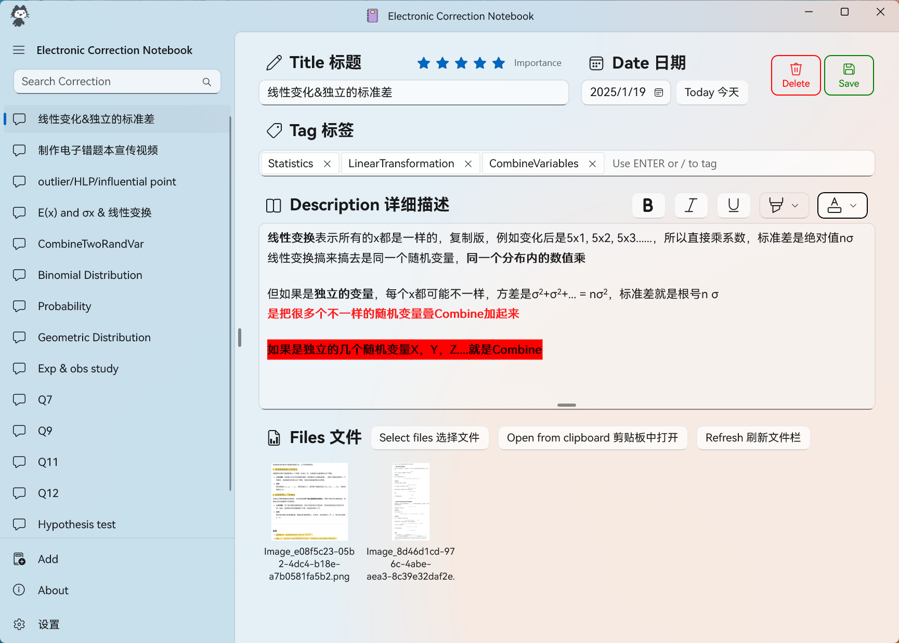
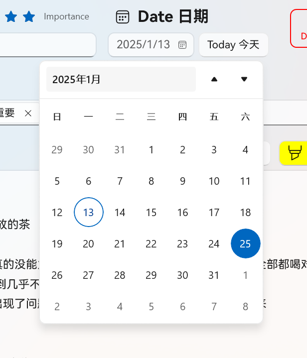
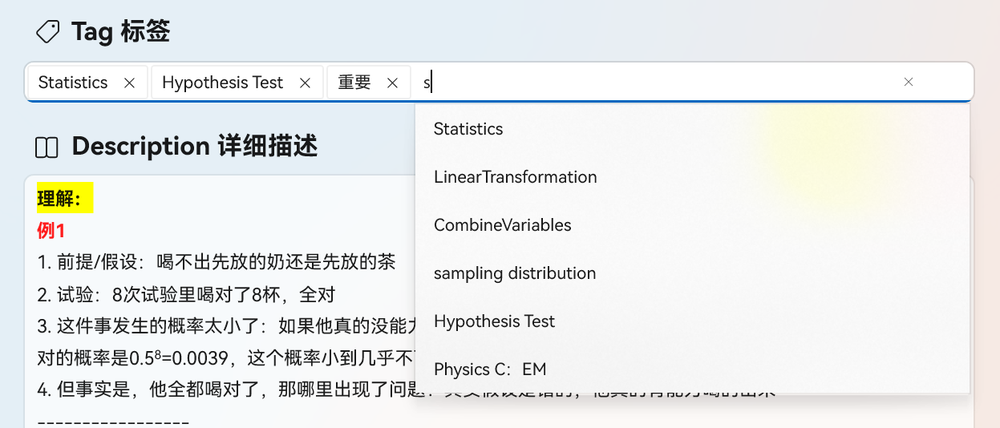
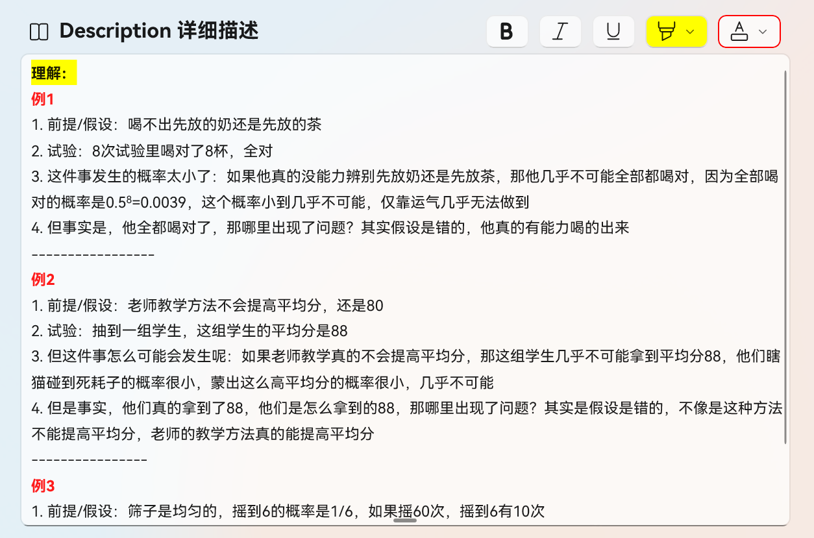
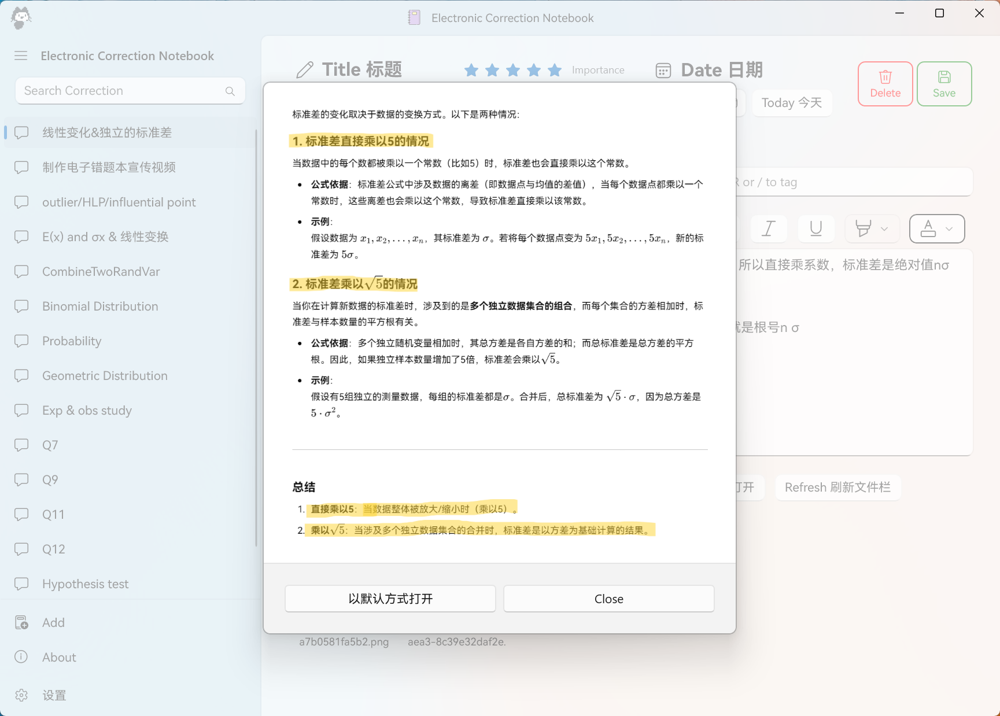
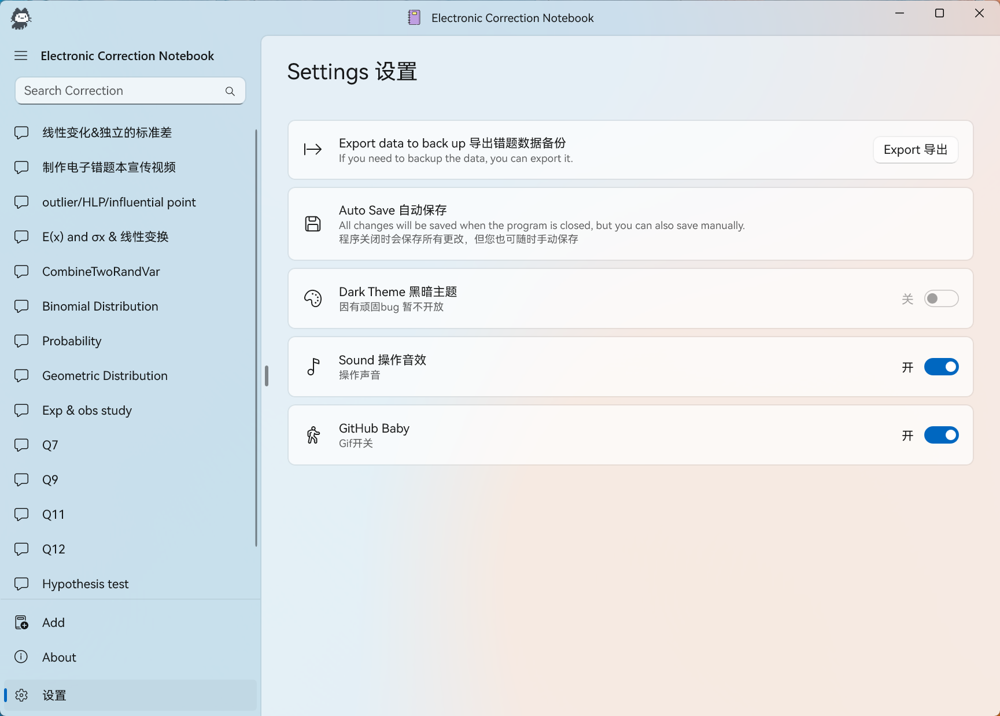

# Electronic Correction Notebook 📖 Windows端电子错题本

## ⁉️ 你是否... Do you... 
经常犯同一个错误？而且令你恼怒？造成不便？考试吃亏？快看看这个电子错题本吧！   
Have you ever made the same mistakes? and made you angry? caused inconvenience? lost marks in exams? Come and see the Electronic Correction Notebook!

## 📢 简介 Introduction 
A Electronic Correction Notebook for Windows, used to record and review your mistakes in any practices(eg. exams, cooking, sports), and any other mistakes you made previously. I hope this can help you improve your efficiency in learning and working.   
Windows端开发的电子错题本，用于记录和复习你在任何练习中的错误（例如考试、做饭、运动），帮助提高学习和工作的记忆效率

## 🪶 作者信息 About me
Grade 12 in international high school in China, waiting for offers of universities....   
高三再读，等候大学录取

## 🤖 技术栈 Technology stack：
WinUI3

## 🚩 未来计划 持续更新中 Future features...  🔥 
- [ ] 添加Tag筛选功能 Tag filter
- [ ] 添加错题导出pdf功能 Export to pdf to share
- [ ] 添加主题颜色选择功能 Pick theme colors

### 🌟 支持的话就给个Star或Watch吧！Give me a star or watch if you like it! 🌟

## 🕶️ Main Page 主页面 - 已启用Mica-BaseAlt效果 Win11食用效果更佳

## 📅 Date Picker 日期选择

## 🏷️ Adding existed tag or create new 添加已存在的标签或新建标签
后续会新增tag筛选功能   
Add tag filter in the future.   

## 📋 Rich Edit Box 富文本编辑器-rtf文件保存在本地
后续会添加rtf文件导入导出功能   
Add export .rtf files in the future.   

## 🗃️ Attach Files 附加文件
如果需要在图片上做标注，建议使用下方预览功能，以默认方式打开，然后标注保存，接着请点击刷新文件栏以显示最新的图片更改   
If you want to annotate on the image, please use the preview function below, open it in the default way, annotate and save, then click the refresh button to show the latest image changes.   

## 📊 Files 文件预览
可预览txt文本，视频，音频，图片   
Support previewing text, video, audio, image files.   

## ⚙️ Settings 设置
以后会假如更多的设置功能  
Add more setting setters in the future.   

